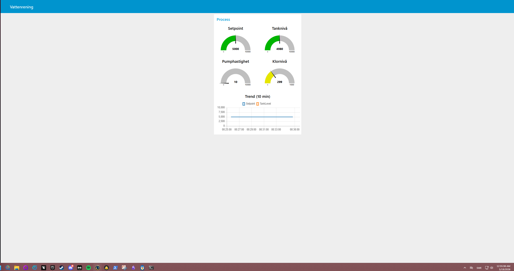
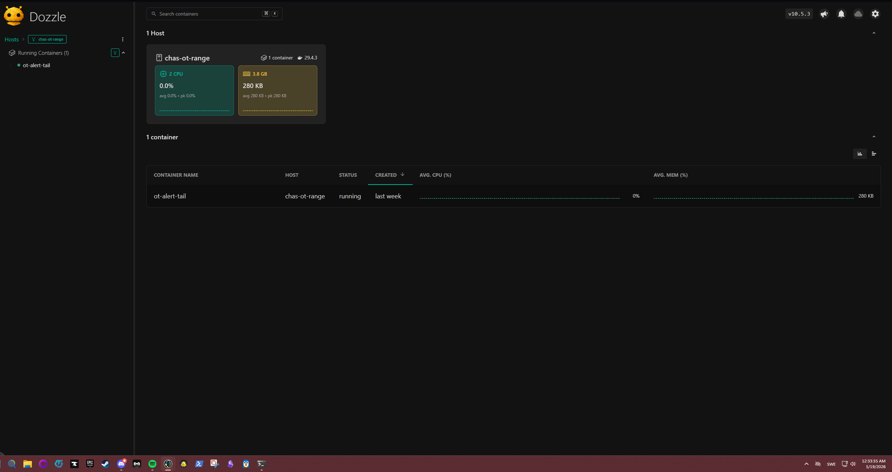

# ICS-arkitektur — Chas OT-range (snabbspår)

## Sammanfattning
Miljön simulerar ett enkelt vattenreningssystem där en PLC styr processen via Modbus TCP. Ett HMI-system läser av sensordata en gång per sekund och visar informationen i en dashboard. Samtidigt övervakar en Suricata-instans nätverkstrafiken mellan IT- och OT-segmenten för att upptäcka misstänkt aktivitet.

## Komponenter
| Komponent      | Roll              | IP-adress     | Port  | Protokoll      |
|----------------|------------------|---------------|-------|----------------|
| OpenPLC        | PLC runtime       | 10.0.50.10    | 502   | Modbus TCP     |
| OpenPLC web    | PLC config        | 10.0.50.10    | 8080  | HTTP           |
| Node-RED HMI   | HMI/SCADA         | 10.0.50.20    | 1880  | HTTP (dashboard)|
| Suricata       | IDS               | host          | -     | sniffar br-ot  |
| Attacker       | (dual-homed)      | 10.0.10.99 / 10.0.50.99 | - | - |

## Nätverkssegmentering
Systemet är uppdelat i två nätverk:

1. br-ot (10.0.50.0/24)
Innehåller OT-utrustning som PLC och HMI.

2. br-it (10.0.10.0/24)
Innehåller IT-sidan och angriparsystemet.

### Viktiga designval
1. HMI:n är ansluten till både IT- och OT-nätet
(10.0.10.20 och 10.0.50.20).
Detta är avsiktligt eftersom operatörer från IT-sidan måste kunna nå dashboarden samtidigt som HMI:n kommunicerar med PLC:n i OT-nätet.

2. Angriparen är också dual-homed
(10.0.10.99 och 10.0.50.99).
Detta är däremot en dålig säkerhetsdesign eftersom det bryter segmenteringen mellan IT och OT. Labbens andra del fokuserar på att åtgärda detta.

## Modbus mapping
|Register |Funktion     |
|---------|-------------|
|HR0      |SetPoint     |
|HR1      |TankLevel    |
|HR2      |PumpSpeed    |
|HR3      |ChlorineLevel|

|Coil     |Funktion     |
|---------|-------------|
|Coil 0   |DosingValve  |
|Coil 1   |Alarm        |

## Kommunikationsflöden
1. HMI → PLC: Läser register 0–3 via Modbus TCP (Function Code 3) en gång per sekund.

2. Normal drift: Systemet är designat för att endast läsa data, inte skriva till PLC:n under vanlig drift.

3. Operatör → HMI: Åtkomst sker via HTTPS bakom en nginx-proxy med basic authentication.

## Purdue-modellen — mappning
| Nivå | Vad det är           | Vår motsvarighet |
|------|----------------------|------------------|
| 0    | Fysisk process       | (simulerad)      |
| 1    | PLC / kontrollers    | OpenPLC          |
| 2    | HMI / SCADA          | Node-RED HMI     |
| 3    | Site operations      | (saknas)         |
| 4    | Företags-IT          | Attacker-host    |
| 5    | Internet             | (saknas)         |

## Bilder
- 
- 
